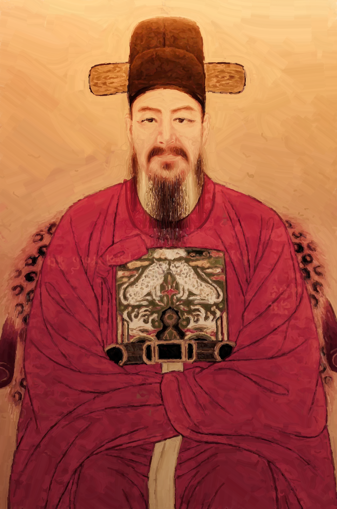

# Digital Drawing — 붓 터치로 그린 초상화

조선시대 관복 초상화(`reference.png`)를 **붓 터치만으로** 따라 그리는 작은 브라우저 그림판입니다.
사진을 캔버스에 직접 붙이지 않고, 약 18만 개의 붓 터치가 화가처럼 한 획씩 쌓여 그림이 완성됩니다.



## 어떻게 그리나요?

화가가 사진을 옆에 두고 "아직 덜 닮은 곳"에만 덧칠하는 과정을 코드로 흉내 냈습니다.

| 단계 | 붓 크기 | 하는 일 |
| --- | --- | --- |
| Blocking in | 68–112px | 큰 덩어리와 전체 색 잡기 |
| Form and color | 24–40px | 형태와 색 쌓기 |
| Refinement | 8–14px | 주름선·윤곽 다듬기 |
| Fine details | 2–5px | 눈·입·수염 한 올·흉배·각대 묘사 |

- 붓 터치는 격자가 아니라 **형태의 결(구조 텐서 방향)** 을 따라 휘어집니다.
- 큰 붓은 여러 가닥의 모(bristle)로, 작은 붓은 둥근 붓으로 그립니다.
- 사진은 "어디에, 무슨 색으로, 어느 방향으로 칠할지" 계획할 때만 쓰입니다.

## 실행

```bash
python -m http.server 8770
```

브라우저에서 http://localhost:8770 을 열면 빈 캔버스에서 약 15초 동안 그림이 그려집니다.

## 파일 구성

| 파일 | 역할 |
| --- | --- |
| `index.html`, `style.css` | 화면 (상단 바·툴바·캔버스·Reference 패널) |
| `app.js` | `strokes.js`의 붓 터치를 한 획씩 재생 |
| `strokes.js` | 생성된 붓 터치 데이터 (자동 생성) |
| `plan_strokes.py` | 참고 이미지를 분석해 붓 터치 계획을 만드는 스크립트 |
| `reference.png` | 참고 이미지 |
| `final_canvas.png` | 완성된 캔버스 캡처 |

## 붓 터치 다시 만들기

```bash
pip install numpy pillow scipy
python plan_strokes.py sim.png
```

`strokes.js`가 새로 만들어집니다. 두 번째 인자로 브라우저에서 저장한 실제 캔버스 PNG를 주면, 어긋난 곳만 고치는 마무리 손질 획이 추가됩니다.

```bash
python plan_strokes.py sim.png canvas.png
```
